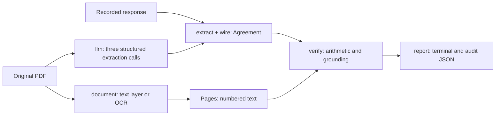

# From PDF to S106 audit

This is one Rust crate with a library and CLI. Start with `main.rs`'s `Audit` arm,
then `extract::extract` and `verify::verify`. The pipeline has two readings of the
same PDF: the model extracts proposed facts; PDFium/OCR supplies page text against
which the deterministic verifier checks the citations. Neither reading establishes
that every obligation has been found.



## The reading path

1. **Load the document.** `document::load` hashes the file, opens it with PDFium,
   and visits every PDF page. A page with at least 50 non-whitespace text-layer
   characters uses that layer. Otherwise it is rendered at 200 DPI and recognised
   with the configured OCR models, one page per call so that a page's text never
   depends on which other pages were read with it. OCR starts only when needed.
   This threshold detects sparse text, not whether a substantial text layer is
   accurate; a bad existing OCR layer may therefore be used.

2. **Keep layout and derive matching text.** `Document` stores `PageText` records
   with a 1-based PDF page index, source, dimensions and `Line` boxes. Text-layer
   boxes use PDF points from the top left; OCR boxes use rendered pixels. They are
   not interchangeable units. Text-layer characters are grouped into words and
   then lines; word boxes are intermediate and are not retained in `Document`.
   OCR regions retain their own boxes. `Document::pages()` builds a `BTreeMap` of
   page index to text, joining OCR boxes on the same visual row and omitting tiny
   side-margin specks from matching text only. Original boxes remain available.

3. **Choose live extraction or replay.** `main::credentials` and `extract::answer`
   implement `Auto`, `Live`, `Record` and `Replay`. Auto is live when a client can
   be constructed; use explicit `--llm-mode replay` for reproducibility and no
   model calls. Live mode attaches the **entire PDF**, capped at 300 loaded pages.
   There is no source-page ranking or excerpt selection in the current live path.
   Instrument/metadata/variations, housing, and contributions use three calls
   because the combined output grammar exceeded the API limit. OCR text is not
   sent as the extraction prompt. The PDF is not prompt-cached between schemas.

4. **Deserialize and convert.** `llm::schema_for` makes Schemars output compatible
   with strict structured outputs. `llm::extract` delegates transport retry to the
   SDK and retries invalid JSON up to three attempts. Valid JSON is not yet a valid
   Agreement: `extract::to_agreement` deserializes the wire types, with nested field
   paths in type errors, then calls the conversion functions in `wire.rs`.
   Empty citations become `None`; attachment positions pass through `PageMap`.
   Group contribution terms are removed; trigger labels come from the fixed
   vocabulary, with a covenant fallback for single triggers. The conversion does
   not prove evidence. Numeric fields become `Observed<T>`: the extractor's string is
   kept as `raw` beside the parse result, so a malformed nonempty string is a typed
   `ParseError` (code, cause, byte span), not a silent `None`. `to_agreement` also
   records `Agreement.run`, the run identity (see `docs/numeric-parsing.md`).

5. **Verify.** `verify::verify` lists the checks in execution order. Each check
   computes its assertion and supplies `Input` values and citations to `resolve`.
   `grounding_problem` first checks that the value occurs in its snippet, then
   `evidence_found` relocates that snippet on its cited page. Matching tolerates
   whitespace loss and bounded column interleaving. Decimal points and numeric
   boundaries are retained; numeric tokens cannot be skipped as garbled words.
   No fuzzy-similarity score substitutes for these rules. Numbers are read by
   `quantity.rs` (one tokenizer, one grammar, units `Gbp`/`Percent`/`Count`) and the
   claimed value must occur in the snippet with the unit the field expects.
   `evidence::locate` returns where the snippet matched, plus any OCR digit repairs;
   a numeric value is never verified through a repair. Each numeric problem is a
   typed `audit::Finding` (NUM001-NUM006) attached to its check.

6. **Optionally escalate.** With `--escalate`, Parser Errors trigger another
   complete extraction using the stronger model. `extract::escalate` groups check
   IDs by housing, instrument or contribution name. It accepts a candidate section
   when Parser Errors decrease, at least as many checks run and its implemented
   presence checks find no loss. These presence checks are incomplete (see below).
   The CLI re-verifies the merged agreement and records the merge log as a warning.
   Each adopted field group also adds a `ReplacementIdentity` to `Agreement.run`, so a
   finding's `extraction_sha256` names the extraction its field came from.
   REVIEW alone does not trigger escalation.

7. **Report.** `report::render` prints the agreement and check results;
   `AuditJson` writes both to JSON. `report::exit_code` returns 2 for any Document
   Discrepancy, otherwise 1 for Parser Errors or REVIEW, otherwise 0. An all-SKIP
   result can therefore exit 0; exit 0 is not proof of completeness or compliance.
   The stated-sum total includes fixed sums and caps at their maxima, excluding
   rates and formula parameters. Conditional sums may never become payable.

## Check outcomes and uncertainty

For checks routed through `resolve`, missing required values fail as Parser Error.
Otherwise:

| Assertion | All inputs grounded | Outcome |
|---|---|---|
| holds | yes | PASS |
| holds | no | REVIEW |
| fails | yes | FAIL / Document Discrepancy |
| fails | no | FAIL / Parser Error |

Checks explicitly SKIP when their prerequisites or scope do not apply. H1–H4 skip
whole-scheme arithmetic for variations/supplemental deeds; H4 never substitutes
unit counts for floorspace or an unstated percentage basis. Missing scheme-wide
habitable-room evidence cannot be repaired by calculating a convenient denominator.
Instalment arithmetic checks each share against its citation as well as summing
shares. A quotation that only states timing cannot by itself ground the share.
Some direct checks (such as payment covenant recognition) have their own explicit
branches. Read their descriptions alongside the status, not the status alone.

A Document Discrepancy means a contradiction in grounded extracted/OCR inputs.
Confirm it against the original page before treating it as something the deed says.
A PASS only concerns that check's assertion and current grounding mechanism.

## Ownership and useful entry points

| Module | Responsibility / entry point |
|---|---|
| `main.rs` | CLI modes, orchestration, output paths and exit code |
| `document.rs` | `load`, `Document::pages`: PDFium, OCR, cache and layout |
| `extract.rs` | `extract`, `escalate`: prompts, fixtures, conversion orchestration and candidate adoption |
| `wire.rs` | `WireExtraction`, `PageMap`: model-facing contract and explicit conversion |
| `llm.rs` | `extract`, `schema_for`: SDK request/response and provider schema constraints |
| `schema.rs` | `Agreement`: durable domain fields, evidence and provenance |
| `verify.rs` | `verify`, `resolve`: check inventory and status decision |
| `quantity.rs` | `scan`, `decimal`, `integer`, `amount`: tokenizer, grammar, units, parse errors |
| `audit.rs` | `Finding`, `RunIdentity`, `parser_fingerprint`: typed findings and run provenance |
| `evidence.rs`, `text.rs`, `triggers.rs` | `locate`: relocation; text normalisation; deterministic payment vocabulary |
| `report.rs` | Terminal presentation, `gbp`, and borrowed `AuditJson` view; the JSON holds the agreement (with `run`) and `verification[].findings` |
| `eval.rs`, `ocrbench.rs` | Register comparison/run agreement; OCR against transcribed gold |

The coupling is intentional: wire and verifier both use the domain enums, so
vocabulary is defined once. Extraction depends on verification only for escalation;
the verifier has no model or PDF dependency. `Document::pages` is the boundary between
layout and text-based verification. `llm` owns SDK calls, though its concrete client
type still appears in orchestration signatures; no transport trait is needed yet.
The wire/domain separation is useful because provider grammar constraints should
not dictate how an audit represents missing evidence or legacy data.

## Adding an obligation

An additional ordinary fixed contribution usually needs no new enum or verifier:
it already fits `Contribution { amount, conditionality, payment }`. Check whether
`TASK_CONTRIBUTIONS` includes its naming convention (currently singular terms ending
in Contribution plus Administration Cost). Add a small source excerpt and conversion/
verification tests. If extending the prompt, deliberately update recorded responses;
never relabel an old answer with a new prompt hash.

For a genuinely different obligation, such as an in-kind delivery requirement:

1. Define the fact and its evidence in `schema.rs`, including uncertainty and units.
   Decide whether it belongs in an existing facet before adding a new collection.
2. Add model-facing fields in `wire.rs`, their conversion, and a focused instruction
   in `extract.rs`. Schema descriptions enter the prompt hash. Consider a versioned
   fixture change and keep old records readable; do not rewrite their provenance.
3. Add a named deterministic check in `verify.rs` and register it in `verify`.
   Use `Input`/`resolve` for assertion plus evidence outcomes. Test a valid case,
   a missing value, wrong-page evidence, and a plausible invented value.
4. Make the new fact visible in `report.rs`. Update `eval.rs` only if it belongs in
   the explicitly defined comparison metric; add independent labels before claiming
   precision or recall for it. Review escalation's preservation policy for the field.

Those edits cross the input contract, domain, check and presentation layers for a
reason. They do not require changes to PDF rendering, OCR or the HTTP client. Avoid
a registry of plug-in obligation handlers until concrete requirements justify one.

## Reproducing and investigating a finding

Use the exact PDF SHA-256 from the audit and its original filename (fixture lookup
uses the stem), the recorded model fixture, the code revision and OCR configuration:

```sh
cargo run --release -- audit data/raw/<id>.pdf --llm-mode replay
cargo run --release -- audit data/pages/<id>.pages.json   # no PDF needed
cargo run --release -- eval --replay
cargo test                    # tier 1, no data needed; see docs/testing.md
cargo test-data               # tier 2, needs the data checkout
cargo test-pdf && cargo test-corpus
```

`S106_DATA` (or the global `--data <dir>` flag), `S106_MODELS` and `S106_OCR_CACHE` override locations. `S106_OCR_WORKERS=<n>` (default 1, opt-in) OCRs n pages at a time, each on its own engine and still one page per call; it uses about 0.3 GB more memory per extra worker, and `cargo test-pdf` on the real PDFs should pass with it before it becomes a default. Fixtures live
at `data/extractions/<stem>/<model>.extract.v2.json` and check PDF and prompt/schema
hashes. When no v2 fixture exists, `extractions-v1` can replay through an adapter; it does
not have the same prompt-hash validation. Page positions in old excerpts are mapped
by their stored page list. No replay path requires credentials.

The candidate list and the register rows for those deeds are kept in the
data repository's `eval/` (see its README for where they came from); `--register` points the
evaluation at a full download instead. `corpus/manifest.tsv` in the data repository is the retrieval manifest
for the deeds themselves.

Page text lives at `data/interim/ocr/<sha256-prefix>-<ocr-version>/page_NNN.json` and,
for the recorded corpus, in `data/pages/<stem>.pages.json` (one page per line).
Open the cited page record, check the literal snippet and value, then inspect the
original PDF page. If relocation fails, compare `Document::pages()`'s row text
with the retained boxes. A matching amount elsewhere on a page is insufficient.
`tests/evidence.rs` and `tests/verify.rs` show how to reduce a discrepancy to a small
reproducible excerpt without a PDF or live call.

The cache key hashes the line-logic version, OCR settings and the pinned SHA-256 of
every runtime artifact; files that differ from their pins are refused before use, and
the manifest is validated on read. Cached page files are not authenticated individually:
a hand-edited cache file is read as it is, which the snapshot comparison in the
real-PDF test tiers would expose. Commit the snapshot of the text used for a research run.

## Remaining complexity and limits

- OCR ordering, lost whitespace and column interleaving require custom rules. The
  narrow matcher is preferable to a general fuzzy threshold that could forgive an
  incorrect amount. It still cannot prove which legal concept a nearby number names.
- Mix-table grounding checks number multiplicities per line, not row/column identity.
  Parent checks relocate a citation; variation checks ground a target token, not
  the full operation or replacement text. Payment checks recognise a covenant but
  do not establish its association with a particular contribution. These are
  limitations, not permission to infer missing legal facts.
- Model classification drives variation gating. Metadata, unconditional labels,
  indexing flags and complete obligation coverage are not independently verified.
- Escalation's loss checks do not cover every field. Provenance keeps the original
  extraction label plus a warning, and `Agreement.run.replacements` records which
  field groups came from which extraction. Use escalation as a review aid, not an
  established safeguard against loss of obligations.
- The parser fingerprint covers the probe corpus in `fixtures/numeric-probes.txt`,
  not every possible input; `tests/numeric_snapshot.rs` is the review gate for changes
  in the parser's results on that corpus.
- Register evaluation is a diagnostic cross-check, not an extraction gold set.
  Purpose totals, instalments and duplicate register rows complicate comparisons.
  Run agreement compares selected fields and does not compare complete agreements.
- Cached replay and frozen Python outputs test reproducibility/compatibility. The
  small OCR gold set helped select the OCR model; it is not held-out validation.
  Replay from snapshots is only as good as the snapshots' agreement with the PDFs,
  which tiers 3 and 4 check (docs/testing.md).
  No live model calls are needed to test deterministic verification changes.
