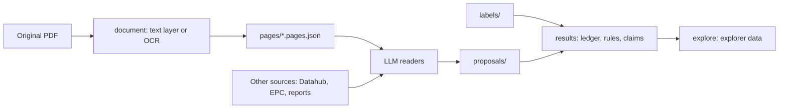

# From PDF to results

The code is one Rust crate with a library and a CLI, plus the results explorer in `explorer/`
(a separate crate). The crate does the deterministic parts of the pipeline: it turns deeds into
page text, saves Datahub snapshots, and builds results from what the readers proposed. The
reading itself is done by LLM readers run as agent sessions; their output lands as proposals
under `proposals/` in the data repository, and the data repository's `docs/verification-rule.md`
says how the readings are checked.



## The reading path

1. **Load the document.** `document::load` hashes the file, opens it with PDFium,
   and visits every PDF page. A page with at least 50 non-whitespace text-layer
   characters uses that layer. Any other page is rendered at 200 DPI and recognised
   with the configured OCR models, one page per call, so a page's text never
   depends on which other pages were read with it. OCR starts only when needed.
   The 50-character threshold detects sparse text, not whether a substantial text
   layer is accurate, so a bad OCR layer already in the PDF may be used as it is.

2. **Keep layout and derive page text.** `Document` stores `PageText` records
   with a 1-based PDF page index, source, dimensions and `Line` boxes. Text-layer
   boxes use PDF points from the top left; OCR boxes use rendered pixels. The two
   units are not interchangeable. Text-layer characters are grouped into words and
   then lines; word boxes are intermediate and are not kept in `Document`. OCR
   regions keep their own boxes. `Document::pages()` builds a `BTreeMap` from page
   index to text, joining OCR boxes on the same visual row and dropping tiny
   side-margin specks. The original boxes stay available.

3. **Snapshot.** `s106 pages --write data/pages` writes each deed's page text, with the
   settings and model set that produced it, to `pages/<stem>.pages.json` in the data
   repository. That snapshot is what the readers are given and what their quotes cite.

4. **Results.** `s106 results` reads a batch's blank sheet, the proposals and any labels,
   and writes the scheme ledger, the batch's decision rules and its claims, each with its
   check level. `s106 explore` bakes the explorer's data from the Datahub baseline and,
   for the public site, the deed cells of a results folder.

## Ownership and useful entry points

| Module | Responsibility / entry point |
|---|---|
| `main.rs` | CLI commands, output paths and exit codes |
| `document.rs` | `load`, `Document::pages`, `Snapshot`: PDFium, OCR, cache, layout and snapshots |
| `ocrbench.rs` | OCR scored against transcribed gold pages |
| `data.rs` | where the data checkout is and the paths inside it |
| `pld.rs` | Datahub client and append-only snapshots (`s106 pld`) |
| `labels.rs` | Human labels; agent proposals scored against them (`s106 labels`) |
| `results.rs` | `run`: a batch's scheme ledger, decision rules and claims, each with its check level (`s106 results`) |
| `figures.rs` | `check`: figures cited in markdown as `29.8%<!-- src: path -->` must still appear in the cited file (`s106 check-figures`) |
| `explore.rs` | `bake`: data for the results explorer in `explorer/` (`s106 explore`): Datahub figures, plus the public deed cells (`--deed-cells`) or a private ledger (`--results`) |

`results.rs` depends on `labels.rs` for loading labels and proposals; nothing else depends on
either. `explore.rs` reads files only.

## Reproducing page text

```sh
cargo run --release -- pages data/raw/<id>.pdf --check data/pages
cargo test                    # tier 1, no data needed; see docs/testing.md
cargo test-data               # tier 2, needs the data checkout
cargo test-pdf && cargo test-corpus
```

`S106_DATA` (or the global `--data <dir>` flag), `S106_MODELS` and `S106_OCR_CACHE`
override locations.

`S106_OCR_WORKERS=<n>` (default 1, opt-in) OCRs n pages at a time, each on its own
engine and still one page per call. Each extra worker uses about 0.3 GB more memory,
and the setting keeps its own cache (keyed by workers and threads). `cargo test-pdf`
on the real PDFs should pass with more than one worker before the setting becomes a
default.

Scans are read with PP-OCRv6 tiny by default (since October 2026): 2.6x faster than
PP-OCRv5 mobile on 15 recorded deeds (4 vCPUs), with different but not clearly worse
text (see `docs/ocr-speed.md`). `S106_OCR_MODELS=<set>` picks another model set, e.g.
`ppocrv5-en-mobile`. Snapshots made before the switch keep PP-OCRv5 page text, so the
pages, quotes and boxes cited from them stay valid; each snapshot records its model
set, and the tests and `s106 pages --check` re-read a PDF with the set its snapshot
names.

Page text lives at `data/interim/ocr/<sha256-prefix>-<ocr-version>/page_NNN.json` and,
for the recorded corpus, in `data/pages/<stem>.pages.json` (one page per line).
`corpus/manifest.tsv` in the data repository is the retrieval manifest for the deeds.

The cache key hashes the line-logic version, OCR settings and the pinned SHA-256 of
every runtime artifact; files that differ from their pins are refused before use, and
the manifest is validated on read. Cached page files are not authenticated one by
one: a hand-edited cache file is read as it is, and the snapshot comparison in the
real-PDF test tiers would expose the edit. Commit the snapshot of the text used
for a research run.

## Limits

- OCR ordering, lost whitespace and column interleaving remain in the page text; a reader's
  quote has to be checked against the page it cites.
- The small OCR gold set helped select the OCR model; it is not held-out validation.
  Snapshots are only as good as their agreement with the PDFs, which tiers 3 and 4 check
  (docs/testing.md).
